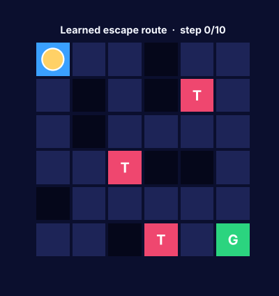
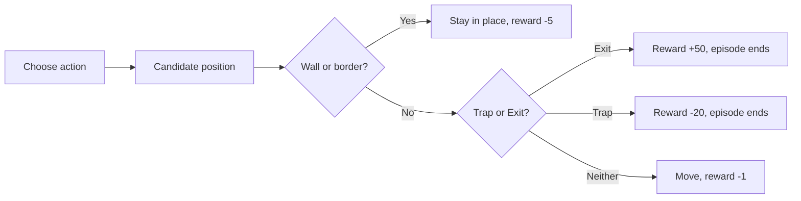
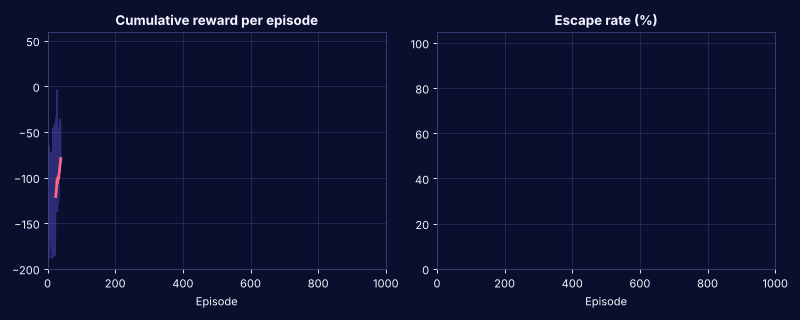
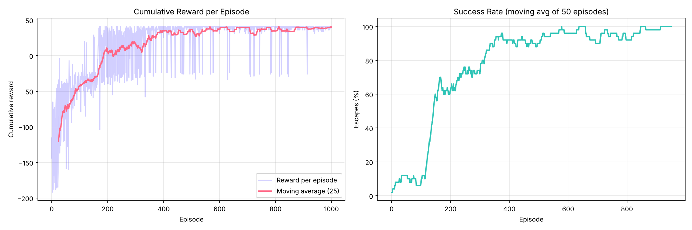
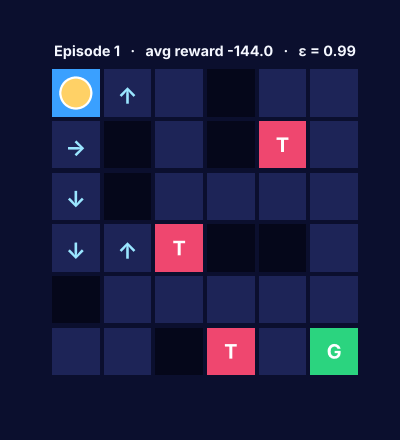
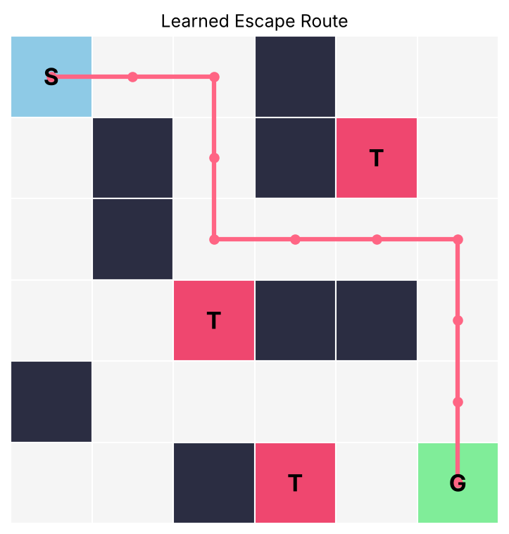

<div align="center">

#  Maze Escape
### Learning to Escape a Maze with the Incremental Mean

**Monte Carlo Reinforcement Learning in Python**

<a href="https://www.kaggle.com/code/mohammedsalah01/maze-escape">
  
</a>




-6C63FF)


[**Kaggle Notebook**](https://www.kaggle.com/code/mohammedsalah01/maze-escape) · [**Run the Code**](#-quick-start) · [**Results**](#-results)

</div>

---

## 📌 Overview

**Maze Escape** is a reinforcement learning project in which an agent learns to find the exit of a 6×6 maze **purely from experience**. The agent starts with zero knowledge of the map. After every complete episode, it updates the value of each action it tried using the **Incremental Mean** of the observed returns, and it balances exploration and exploitation with an **ε-greedy** policy.

This project was built for a Reinforcement Learning course assignment. It covers every required part: defined states, actions, rules and rewards, Q-values and visit counters initialised to zero, full-episode generation, incremental mean updates, ε-greedy action selection, 1,000 training episodes (at least 500 required), final Q-values, the learned policy, and a cumulative reward plot with discussion.

## 🎮 The Game

| Symbol | Meaning |
|:---:|---|
| `S` | Start cell, `(0, 0)` |
| `G` | Goal / Exit, `(5, 5)` |
| `T` | Trap, which ends the game with a penalty |
| `#` | Wall, which blocks movement |
| `.` | Free cell |

```
S . . # . .
. # . # T .
. # . . . .
. . T # # .
# . . . . .
. . # T . G
```

**How it is played:** the agent begins at `S`. On each turn it picks one move: Up, Down, Left or Right. An episode ends when the agent reaches the exit, steps on a trap, or hits 60 steps.

## 🧩 Environment Design

### State space
A state is the agent's position `(row, col)`. The grid has 36 cells, 8 of which are walls. That leaves 28 reachable cells, of which 24 are non-terminal decision states. The terminal states are the exit `(5, 5)` and the three traps.

### Action space

| ID | Action | Move `(Δrow, Δcol)` |
|:--:|:------:|:-------------------:|
| 0 | UP | (−1, 0) |
| 1 | DOWN | (+1, 0) |
| 2 | LEFT | (0, −1) |
| 3 | RIGHT | (0, +1) |

The Q-table therefore has 24 states × 4 actions.

### Transition rules



Transitions are **deterministic**: the same state and action always give the same result. An episode also ends after 60 steps (time-out).

### Reward function

| Outcome | Reward | Why |
|---|:---:|---|
| Normal move | **−1** | Encourages short paths |
| Wall / border | **−5** | Discourages useless moves |
| Trap | **−20** | Teaches danger |
| Exit | **+50** | Main objective |

The discount factor is `γ = 0.99`. The best possible route takes 10 steps, which gives `9 × (−1) + 50 = +41`.

## 🧠 Algorithm: First-Visit Monte Carlo with the Incremental Mean

Instead of storing every return and averaging at the end, the agent updates its estimate one episode at a time:

$$N(s,a) \leftarrow N(s,a) + 1$$

$$Q(s,a) \leftarrow Q(s,a) + \frac{1}{N(s,a)}\Big(G - Q(s,a)\Big)$$

where the return is computed backwards through the episode: $G_t = r_t + \gamma\, G_{t+1}$.

**Training loop**
1. Initialise `Q(s,a) = 0` and `N(s,a) = 0` for every state-action pair.
2. Generate a **complete episode** with the ε-greedy policy.
3. Compute the return `G` for every step, working backwards.
4. For each first-visited `(s, a)`: increment `N`, then apply the incremental mean update.
5. Decay ε and repeat.

**Exploration:** ε starts at `1.0`, is multiplied by `0.995` after every episode, and stops at `0.05`.

## ⚙️ Hyperparameters

| Parameter | Value |
|---|:---:|
| Episodes | 1000 |
| Discount factor γ | 0.99 |
| ε start / min / decay | 1.0 / 0.05 / 0.995 |
| Max steps per episode | 60 |
| Random seed | 42 |

## 📊 Results

### Training progress (average over the last 100 episodes)

| Episode | Avg reward | Escape rate |
|:------:|:----------:|:-----------:|
| 100 | −74.01 | 7% |
| 200 | −19.22 | 33% |
| 300 | 11.17 | 69% |
| 400 | 23.72 | 82% |
| 500 | 32.73 | 92% |
| 700 | 38.23 | 98% |
| 1000 | 38.78 | 99% |

The average reward of the first 100 episodes was **−74.01**, and for the last 100 episodes it was **+38.78**.

<div align="center">

</div>

*The curve draws itself as training progresses. Reward climbs and the escape rate approaches 99%.*

<details>
<summary>Static version of the plot</summary>



</details>

### How the policy evolves during training

<div align="center">

</div>

*Greedy arrows and route at episodes 1, 25, 50, 100, 200, 300, 500 and 1000. Early on the policy is random. By the end it points the agent straight to the exit.*

### Learned policy

```
 →  →  ↓  #  →  ↓
 ↓  #  ↓  #  T  ↓
 ↓  #  →  →  →  ↓
 →  →  T  #  #  ↓
 #  →  ↑  →  ↓  ↓
 ↑  ↑  #  T  →  G
```

### Learned escape route

```
(0,0) → (0,1) → (0,2) → (1,2) → (2,2) → (2,3) → (2,4) → (2,5) → (3,5) → (4,5) → (5,5)
```

**10 steps, +41 total reward**, which is the optimal route for this maze.

<div align="center">

</div>

<details>
<summary>Static version of the route</summary>



</details>

### Discussion
- **Early episodes:** ε is high, so the agent wanders, hits walls and falls into traps, giving strongly negative rewards.
- **Middle episodes:** returns from the exit spread backwards through the Q-values, so useful actions gain positive values and reward rises quickly.
- **Late episodes:** with ε at its 0.05 floor, reward settles near +38. The remaining occasional mistakes come from that small amount of exploration.
- **Why the incremental mean:** it gives the same estimate as averaging all returns, but only needs constant memory per state-action pair.
- **Limitations:** Monte Carlo needs complete episodes and has high variance early on. Temporal-Difference methods such as Q-learning and SARSA are a natural next step.

## 🚀 Quick Start

```bash
# 1. Clone the repository
git clone https://github.com/<your-username>/<your-repo>.git
cd <your-repo>

# 2. Install dependencies
pip install numpy matplotlib pandas jupyter

# 3a. Run the notebook
jupyter notebook maze_escape_incremental_mean.ipynb

# 3b. ...or run the script
python maze_escape_incremental_mean.py

# 4. (Optional) regenerate the GIFs
python make_gifs.py
```

You can also open the notebook directly on [Kaggle](https://www.kaggle.com/code/mohammedsalah01/maze-escape).

## 📁 Repository Structure

```
.
├── maze_escape_incremental_mean.ipynb   # Notebook with explanations and outputs
├── maze_escape_incremental_mean.py      # Standalone script version
├── make_gifs.py                         # Generates the animated GIFs below
├── reward_plot.png                      # Reward and success-rate plots
├── maze_path.png                        # Learned escape route
├── assets/
│   ├── maze_agent.gif                   # Agent walking the learned route
│   ├── policy_evolution.gif             # Policy at different training stages
│   └── learning_curve.gif               # Reward and escape rate animation
└── README.md
```

## 🔭 Future Work
- Larger and randomly generated mazes
- Temporal-Difference learning (Q-learning, SARSA)
- Stochastic transitions (slippery floors)
- Deep reinforcement learning (DQN)

## 👥 Team

| Name |
|---|
| Sama Osama |
| Karim Mohammed |
| Mohammed Salah |

## 🔗 Links
- 📓 [Kaggle Notebook](https://www.kaggle.com/code/mohammedsalah01/maze-escape)
- 🎨 [Canva Presentation](https://canva.link/3kxig2vv11xr350)

---

<div align="center">
Made for the Reinforcement Learning course · If you like this project, give it a ⭐
</div>
